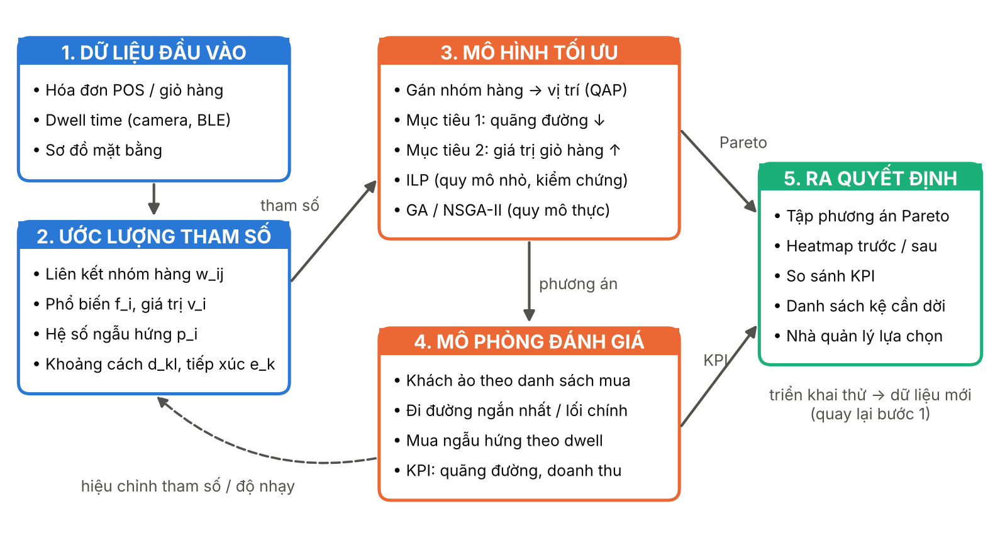
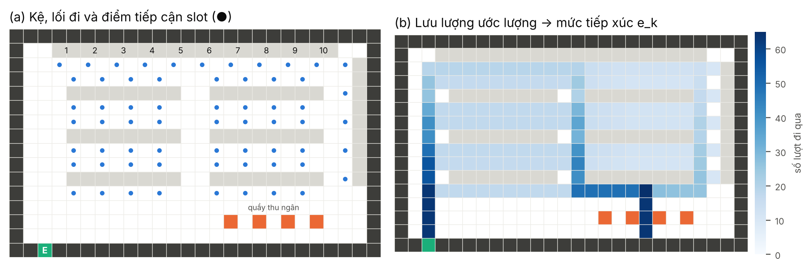

\[TÊN CƠ QUAN CHỦ QUẢN\]

**\[TÊN TRƯỜNG ĐẠI HỌC\]**

**\[KHOA / VIỆN ĐÀO TẠO SAU ĐẠI HỌC\]**

──────── ✦ ────────

**ĐỀ CƯƠNG ĐỀ ÁN**

*(Chương trình định hướng ứng dụng)*

**TÊN ĐỀ TÀI**

**TỐI ƯU HÓA KHÔNG GIAN TRƯNG BÀY**

**VÀ LUỒNG DI CHUYỂN CỦA KHÁCH HÀNG**

**TRONG CỬA HÀNG BÁN LẺ SỐ**

*Smart Retail Floor Allocation*

> **Ngành:** \[Khoa học máy tính / Hệ thống thông tin / Khoa học dữ liệu\]
>
> **Mã ngành:** \[..........\]
>
> **Học viên thực hiện:** \[Họ và tên\] – MSHV: \[..........\]
>
> **Người hướng dẫn khoa học:** \[Học hàm, học vị, họ và tên\]

*\[Địa danh\], tháng 10 năm 2026*

**MỤC LỤC**

PHẦN A. ĐỀ CƯƠNG ĐỀ ÁN 4

1\. Tên đề tài 4

2\. Tính cấp thiết của đề tài 4

2.1. Bối cảnh thực tiễn 4

2.2. Bối cảnh khoa học 4

2.3. Lý do chọn đề tài 5

3\. Tổng quan tình hình nghiên cứu 5

3.1. Bài toán bố trí mặt bằng và bài toán gán bậc hai 5

3.2. Bố trí không gian trong cửa hàng bán lẻ 5

3.3. Hành vi di chuyển và thời gian dừng của khách hàng 6

3.4. Khai phá dữ liệu giỏ hàng 6

3.5. Khoảng trống nghiên cứu và định vị đề án 6

4\. Mục tiêu nghiên cứu 7

4.1. Mục tiêu tổng quát 7

4.2. Mục tiêu cụ thể 7

5\. Câu hỏi nghiên cứu 7

6\. Đối tượng và phạm vi nghiên cứu 8

6.1. Đối tượng nghiên cứu 8

6.2. Phạm vi nghiên cứu 8

7\. Phương pháp nghiên cứu 8

8\. Bố cục dự kiến của đề án 9

9\. Kết quả dự kiến và đóng góp 10

9.1. Về khoa học 10

9.2. Về thực tiễn 10

9.3. Sản phẩm 10

10\. Kế hoạch thực hiện tổng quát 10

11\. Tài liệu tham khảo 11

PHẦN B. HƯỚNG DẪN CHI TIẾT THỰC HIỆN 13

B1. Phát biểu bài toán 13

B2. Bước 1 – Mô hình hóa mặt bằng cửa hàng 14

B2.1. Lưới không gian 14

B2.2. Vị trí trưng bày (slot) và điểm tiếp cận 14

B2.3. Đồ thị lối đi và ma trận khoảng cách 14

B2.4. Mức tiếp xúc của vị trí 15

B3. Bước 2 – Thu thập và xử lý dữ liệu 16

B3.1. Nguồn dữ liệu 16

B3.2. Ánh xạ sản phẩm → nhóm hàng 16

B3.3. Ma trận liên kết, độ phổ biến và lift 16

B3.4. Hệ số mua ngẫu hứng và giá trị nhóm hàng 17

B3.5. Thời gian dừng (dwell time) 17

B3.6. Chuẩn hóa và lưu trữ 18

B4. Bước 3 – Mô hình toán học 18

B4.1. Ký hiệu 18

B4.2. Hai hàm mục tiêu 18

B4.3. Ràng buộc 18

B4.4. Gộp hai mục tiêu 19

B4.5. Tuyến tính hóa để giải bằng ILP 19

B4.6. Mở rộng: nhóm hàng chiếm nhiều slot 19

B5. Bước 4 – Thuật toán di truyền và các phương pháp so sánh 20

B5.1. Mã hóa, khởi tạo và hàm thích nghi 20

B5.2. Toán tử và tham số 20

B5.3. Đánh giá chênh lệch khi hoán đổi 20

B5.4. Mã giả 21

B5.5. NSGA-II cho tập Pareto 21

B5.6. Các phương pháp so sánh 21

B6. Bước 5 – Mô phỏng hành vi khách hàng 21

B6.1. Vì sao cần mô phỏng 21

B6.2. Mô hình tác tử khách hàng 21

B6.3. Mã giả mô phỏng 22

B6.4. Chỉ số đầu ra (KPI) 22

B6.5. Thiết lập, hiệu chỉnh và kiểm định mô phỏng 22

B7. Bước 6 – Thiết kế thực nghiệm và đánh giá 23

B7.1. Bộ dữ liệu thực nghiệm 23

B7.2. Danh sách thí nghiệm 23

B7.3. Thống kê và trình bày kết quả 23

B8. Bước 7 – Xây dựng công cụ hỗ trợ ra quyết định 24

B8.1. Kiến trúc mô-đun 24

B8.2. Cấu trúc thư mục 24

B8.3. Kiểm thử bắt buộc 25

B8.4. Luồng sử dụng dashboard 25

B8.5. Yêu cầu phi chức năng 25

B9. Kế hoạch chi tiết theo tuần 25

B10. Rủi ro và phương án dự phòng 27

B11. Danh mục sản phẩm bàn giao 27

PHỤ LỤC 28

PL1. Mẫu định dạng dữ liệu đầu vào 28

PL2. Câu hỏi hội đồng thường gặp và gợi ý trả lời 28

**DANH MỤC TỪ VIẾT TẮT VÀ KÝ HIỆU**

| **Viết tắt** | **Tiếng Anh**                              | **Nghĩa tiếng Việt**                                  |
|--------------|--------------------------------------------|-------------------------------------------------------|
| ABS          | Agent-Based Simulation                     | Mô phỏng dựa trên tác tử                              |
| BLE          | Bluetooth Low Energy                       | Bluetooth năng lượng thấp (định vị trong nhà)         |
| GA           | Genetic Algorithm                          | Thuật toán di truyền                                  |
| HV           | Hypervolume                                | Thể tích siêu khối (chỉ số chất lượng tập Pareto)     |
| ILP / MILP   | (Mixed) Integer Linear Programming         | Quy hoạch tuyến tính nguyên (hỗn hợp)                 |
| KPI          | Key Performance Indicator                  | Chỉ số đo lường hiệu quả chính                        |
| NSGA-II      | Non-dominated Sorting Genetic Algorithm II | Thuật toán di truyền sắp xếp không trội, phiên bản II |
| OX / PMX     | Order / Partially Mapped Crossover         | Toán tử lai ghép thứ tự / ánh xạ từng phần            |
| POS          | Point of Sale                              | Điểm bán hàng (hệ thống tính tiền)                    |
| QAP          | Quadratic Assignment Problem               | Bài toán gán bậc hai                                  |
| SA / TS      | Simulated Annealing / Tabu Search          | Mô phỏng luyện kim / Tìm kiếm tabu                    |
| SKU          | Stock Keeping Unit                         | Đơn vị mã hàng                                        |
| Dwell time   | Dwell time                                 | Thời gian khách dừng lại tại một vùng/kệ              |
| Slot         | Display slot                               | Vị trí trưng bày (một đoạn kệ gán cho một nhóm hàng)  |

**Cách sử dụng tài liệu**

Tài liệu gồm hai phần. **Phần A** là đề cương theo khung thường dùng cho đề án thạc sĩ, có thể dùng để nộp và bảo vệ đề cương sau khi điền các chỗ trong ngoặc vuông \[ \] và chỉnh theo mẫu của trường. **Phần B** là hướng dẫn kỹ thuật chi tiết từng bước thực hiện: mô hình hóa, dữ liệu, mô hình toán, thuật toán, mô phỏng, thực nghiệm, công cụ và kế hoạch theo tuần. **Phụ lục** gồm mẫu định dạng dữ liệu và các câu hỏi hội đồng thường gặp.

Các khung nền vàng có nhãn “Ghi chú cho học viên” là lời nhắc khi làm, cần xóa trước khi nộp. Kế hoạch được lập cho **24 tuần (khoảng 6 tháng)**; nếu quy định của trường khác, co giãn các giai đoạn theo tỷ lệ tương ứng.

# PHẦN A. ĐỀ CƯƠNG ĐỀ ÁN

## 1. Tên đề tài

- **Tiếng Việt:** Tối ưu hóa không gian trưng bày và luồng di chuyển của khách hàng trong cửa hàng bán lẻ số.

- **Tiếng Anh:** Smart Retail Floor Allocation – Data-driven optimization of display space and customer flow in retail stores.

- **Từ khóa:** bố trí mặt bằng bán lẻ; bài toán gán bậc hai (QAP); thuật toán di truyền; quy hoạch tuyến tính nguyên; tối ưu đa mục tiêu; dwell time; mô phỏng tác tử.

> ***Ghi chú cho học viên:** Nếu tên đề tài đã được khoa giao sẵn thì giữ nguyên. Nếu được phép chỉnh, có thể thêm cụm “dựa trên dữ liệu giỏ hàng và thời gian dừng” để tên đề tài nói rõ điểm khác biệt.*

## 2. Tính cấp thiết của đề tài

### 2.1. Bối cảnh thực tiễn

Trong bán lẻ hiện đại, mặt bằng trưng bày là tài nguyên hữu hạn và có chi phí cao. Cách sắp xếp các nhóm hàng quyết định khách đi qua khu vực nào, nhìn thấy sản phẩm nào, dừng lại bao lâu và cuối cùng mua gì. Tại nhiều cửa hàng, sơ đồ trưng bày vẫn được thiết kế chủ yếu theo kinh nghiệm của bộ phận vận hành và đề xuất của nhà cung cấp. Do chi phí sắp xếp lại kệ và rủi ro sụt giảm doanh thu, các thay đổi hiếm khi được đánh giá định lượng trước khi triển khai.

Cùng lúc đó, cửa hàng “bán lẻ số” thu được ngày càng nhiều dữ liệu. Hóa đơn POS cho biết những nhóm hàng nào thường được mua cùng nhau. Camera, cảm biến WiFi/BLE hoặc thẻ RFID gắn trên xe đẩy cho biết khách đi qua đâu và dừng lại bao lâu (dwell time). Các nghiên cứu về đường đi mua sắm cho thấy hành vi di chuyển trong cửa hàng có cấu trúc và đo đạc được (Larson và cs., 2005); quãng đường khách đi trong cửa hàng có liên hệ với chi tiêu ngoài kế hoạch (Hui và cs., 2013). Câu hỏi thực tiễn đặt ra là: làm thế nào khai thác các nguồn dữ liệu này để đề xuất sơ đồ trưng bày tốt hơn một cách có căn cứ, và đánh giá được tác động trước khi dời kệ.

### 2.2. Bối cảnh khoa học

Bố trí mặt bằng (facility layout) là một nhánh kinh điển của vận trù học, thường được mô hình hóa dưới dạng **bài toán gán bậc hai** – QAP (Koopmans & Beckmann, 1957). QAP thuộc lớp NP-khó và nổi tiếng là khó giải chính xác ngay ở quy mô vài chục vị trí (Loiola và cs., 2007), nên các phương pháp metaheuristic như tìm kiếm tabu (Taillard, 1991) và thuật toán di truyền (Ahuja và cs., 2000) được dùng rộng rãi.

Khác với nhà máy, trong cửa hàng bán lẻ “dòng” không phải là vật liệu mà là khách hàng, và mục tiêu không chỉ là giảm quãng đường mà còn là tăng cơ hội tiếp xúc với hàng hóa. Hai mục tiêu này **xung đột**: giảm quãng đường làm khách tiện lợi hơn nhưng giảm cơ hội mua ngẫu hứng. Ben Abdelaziz và cs. (2024) đã mô hình hóa đánh đổi “ngẫu hứng – tiện lợi” này bằng một mô hình song mục tiêu dạng gán bậc hai, giải bằng tuyến tính hóa và phương pháp ε-ràng buộc trên dữ liệu một siêu thị tại Pháp. Các hướng khác đã đưa dữ liệu vào thiết kế bố trí khối của cửa hàng tạp hóa (Ozgormus & Smith, 2020) và tổng hợp trong chuyên khảo về phân tích không gian bán lẻ (Ghoniem & Maddah, 2023).

Đề án kế thừa hướng tiếp cận trên và bổ sung ba điểm: (i) dùng **dữ liệu thời gian dừng** để ước lượng mức thu hút của vị trí và của nhóm hàng; (ii) kết hợp **ILP** (kiểm chứng ở quy mô nhỏ) với **GA/NSGA-II** (quy mô thực tế); (iii) dùng **mô phỏng tác tử** để đánh giá sơ đồ trước khi triển khai và đóng gói thành công cụ hỗ trợ ra quyết định.

### 2.3. Lý do chọn đề tài

- Có nhu cầu thực tế: quyết định bố trí ảnh hưởng trực tiếp đến doanh thu và trải nghiệm khách, nhưng thường thiếu công cụ định lượng.

- Dữ liệu đã sẵn có hoặc thu thập được với chi phí hợp lý (POS, camera), trong khi các bộ dữ liệu giỏ hàng công khai cho phép xây dựng và kiểm chứng phương pháp.

- Đề tài kết hợp khai phá dữ liệu, tối ưu tổ hợp và mô phỏng – phù hợp định hướng ứng dụng và cho ra sản phẩm cụ thể (công cụ, quy trình).

- Bài toán có nền tảng lý thuyết vững (QAP, tối ưu đa mục tiêu) nên kết quả có thể kiểm chứng bằng benchmark và lời giải tối ưu ở quy mô nhỏ.

## 3. Tổng quan tình hình nghiên cứu

### 3.1. Bài toán bố trí mặt bằng và bài toán gán bậc hai

QAP được Koopmans và Beckmann (1957) đề xuất khi nghiên cứu vị trí các hoạt động kinh tế; Lawler (1963) mở rộng và đưa ra cách tuyến tính hóa. Drira và cs. (2007) tổng quan các dạng bài toán bố trí mặt bằng (kích thước cố định/biến đổi, tĩnh/động, đơn/đa mục tiêu). Loiola và cs. (2007) tổng quan các công thức, cận dưới và thuật toán cho QAP. Thư viện QAPLIB (Burkard và cs., 1997) cung cấp các bộ dữ liệu chuẩn có lời giải tối ưu hoặc tốt nhất đã biết, thường dùng để kiểm chứng cài đặt thuật toán.

### 3.2. Bố trí không gian trong cửa hàng bán lẻ

Hướng nghiên cứu này đưa các đặc thù bán lẻ vào mô hình bố trí: Yapicioglu và Smith (2012) thiết kế không gian bán lẻ có tính doanh thu và quan hệ liền kề trên mạng lối đi dạng vòng (racetrack); Mowrey và cs. (2018) tối ưu cách bố trí giá kệ trong cửa hàng; Flamand và cs. (2018) kết hợp lựa chọn danh mục hàng với phân bổ không gian kệ toàn cửa hàng; Ozgormus và Smith (2020) đề xuất cách tiếp cận dựa trên dữ liệu cho bố trí khối trong cửa hàng tạp hóa; Ben Abdelaziz và cs. (2024) cân bằng mua ngẫu hứng và sự tiện lợi bằng mô hình song mục tiêu. Chuyên khảo của Ghoniem và Maddah (2023) tập hợp nhiều nghiên cứu gần đây, trong đó Botsalı và cs. (2023) phân tích ảnh hưởng của hành vi chọn đường của khách đến bố trí dạng lưới và phân bổ không gian kệ.

### 3.3. Hành vi di chuyển và thời gian dừng của khách hàng

Larson và cs. (2005) dùng dữ liệu RFID gắn trên xe đẩy để khảo sát đường đi trong siêu thị và nhận diện các kiểu di chuyển điển hình. Hui, Fader và Bradlow (2009) đề xuất khung tích hợp để mô hình hóa dữ liệu đường đi trong marketing. Hui và cs. (2013) chỉ ra quãng đường di chuyển trong cửa hàng ảnh hưởng đến chi tiêu ngoài kế hoạch. Đây là cơ sở để đề án đưa **mức tiếp xúc** và **thời gian dừng** vào hàm mục tiêu và mô hình mô phỏng.

### 3.4. Khai phá dữ liệu giỏ hàng

Luật kết hợp (Agrawal & Srikant, 1994) với các độ đo support, confidence và lift là công cụ chuẩn để định lượng mức độ các nhóm hàng được mua cùng nhau. Trong đề án, support đồng xuất hiện được dùng làm “lưu lượng” giữa hai nhóm hàng trong hàm mục tiêu quãng đường, còn lift được dùng để nhận diện các cặp bổ trợ hoặc cần tách biệt.

### 3.5. Khoảng trống nghiên cứu và định vị đề án

**Bảng 1.** *Định vị đề án so với các hướng nghiên cứu liên quan*

<table>
<colgroup>
<col style="width: 33%" />
<col style="width: 33%" />
<col style="width: 33%" />
</colgroup>
<thead>
<tr class="header">
<th><strong>Hướng / công trình</strong></th>
<th><strong>Trọng tâm</strong></th>
<th><strong>Đề án kế thừa và bổ sung</strong></th>
</tr>
</thead>
<tbody>
<tr class="odd">
<td>
QAP kinh điển

(Koopmans &amp; Beckmann, 1957; Loiola và cs., 2007)
</td>
<td>Gán cơ sở vào vị trí, tối thiểu chi phí luồng × khoảng cách</td>
<td>Kế thừa cấu trúc mô hình; luồng = đồng mua giữa các nhóm hàng</td>
</tr>
<tr class="even">
<td>
Bố trí bán lẻ

(Yapicioglu &amp; Smith, 2012; Mowrey và cs., 2018; Ozgormus &amp; Smith, 2020)
</td>
<td>Doanh thu, liền kề, mức tiếp xúc, bố trí khối dựa trên dữ liệu</td>
<td>Bổ sung mức thu hút ước lượng từ dwell time</td>
</tr>
<tr class="odd">
<td>
Ngẫu hứng – tiện lợi

(Ben Abdelaziz và cs., 2024)
</td>
<td>Song mục tiêu, tuyến tính hóa, ε-ràng buộc</td>
<td>So sánh ILP/ε-ràng buộc với NSGA-II ở quy mô lớn hơn</td>
</tr>
<tr class="even">
<td>
Đường đi của khách

(Larson và cs., 2005; Hui và cs., 2013)
</td>
<td>Đo đạc, mô hình hóa đường đi và chi tiêu ngoài kế hoạch</td>
<td>Đưa vào mô phỏng tác tử để đánh giá sơ đồ</td>
</tr>
<tr class="odd">
<td><strong>Đề án này</strong></td>
<td>Dữ liệu giỏ hàng + dwell time → ILP/GA/NSGA-II → mô phỏng → công cụ</td>
<td>Quy trình trọn vẹn, có kiểm chứng, dùng được cho cửa hàng</td>
</tr>
</tbody>
</table>

> ***Ghi chú cho học viên:** Trong 4 tuần đầu, đọc toàn văn các bài trên (và các bài trích dẫn chúng) để bổ sung cột “phương pháp/dữ liệu/hạn chế” cho từng công trình. Khẳng định khoảng trống chỉ sau khi đã tổng quan đủ; tìm thêm các nghiên cứu trong nước trên Google Scholar và các tạp chí, hội thảo Việt Nam.*

## 4. Mục tiêu nghiên cứu

### 4.1. Mục tiêu tổng quát

Xây dựng mô hình, thuật toán và công cụ hỗ trợ ra quyết định bố trí các nhóm hàng trên mặt bằng cửa hàng bán lẻ, dựa trên dữ liệu giỏ hàng và thời gian dừng của khách, nhằm cân bằng giữa quãng đường di chuyển của khách và giá trị giỏ hàng kỳ vọng.

### 4.2. Mục tiêu cụ thể

- **MT1.** Mô hình hóa mặt bằng cửa hàng thành lưới không gian và đồ thị lối đi; tính ma trận khoảng cách giữa các vị trí trưng bày và mức tiếp xúc của từng vị trí.

- **MT2.** Xây dựng quy trình chuyển dữ liệu giỏ hàng và dwell time thành tham số mô hình: ma trận liên kết, độ phổ biến, hệ số mua ngẫu hứng, giá trị nhóm hàng.

- **MT3.** Phát biểu mô hình quy hoạch nguyên song mục tiêu cho bài toán gán nhóm hàng vào vị trí; giải chính xác bằng ILP ở quy mô nhỏ.

- **MT4.** Thiết kế, cài đặt thuật toán di truyền (đơn mục tiêu, có tìm kiếm cục bộ) và NSGA-II (đa mục tiêu) cho quy mô thực tế; so sánh với ILP và các phương pháp cơ sở.

- **MT5.** Xây dựng mô phỏng tác tử để đánh giá sơ đồ đề xuất so với hiện trạng; đóng gói thành công cụ (dashboard) hỗ trợ nhà quản lý ra quyết định.

## 5. Câu hỏi nghiên cứu

- **CH1.** Biểu diễn mặt bằng và chuyển dữ liệu giỏ hàng, dwell time thành tham số định lượng cho mô hình tối ưu như thế nào?

- **CH2.** ILP còn giải được tối ưu đến quy mô nào trong thời gian chấp nhận được? GA đạt sai lệch bao nhiêu so với tối ưu và nhanh hơn bao nhiêu?

- **CH3.** Đánh đổi giữa quãng đường di chuyển và giá trị giỏ hàng kỳ vọng có dạng như thế nào (tập Pareto)? Nên chọn phương án nào và theo tiêu chí gì?

- **CH4.** Sơ đồ đề xuất cải thiện bao nhiêu so với hiện trạng trên các chỉ số mô phỏng, và kết luận nhạy cảm thế nào với các giả định hành vi?

## 6. Đối tượng và phạm vi nghiên cứu

### 6.1. Đối tượng nghiên cứu

- Bài toán phân bổ vị trí trưng bày ở **cấp nhóm hàng** (category/block layout) trong cửa hàng bán lẻ dạng siêu thị mini hoặc cửa hàng tiện lợi.

- Hành vi di chuyển, thời gian dừng và mua sắm của khách trong cửa hàng (ở mức mô hình hóa và mô phỏng).

- Các phương pháp tối ưu: ILP, GA, NSGA-II và các phương pháp cơ sở (tham lam, SA, tìm kiếm tabu).

### 6.2. Phạm vi nghiên cứu

- **Mức quyết định:** gán nhóm hàng vào vị trí kệ; không xét phân bổ chi tiết từng SKU trên từng tầng kệ.

- **Mặt bằng:** 2D, một tầng, kết cấu kệ và lối đi cố định; chỉ thay đổi nhóm hàng đặt trên mỗi vị trí. Một lối vào, một khu thu ngân (có thể mở rộng).

- **Dữ liệu:** bộ dữ liệu giỏ hàng công khai (Instacart, dunnhumby); dwell time thu thập thử quy mô nhỏ hoặc mô phỏng có hiệu chỉnh; dữ liệu cửa hàng thật nếu có đơn vị hợp tác.

- **Quy mô thực nghiệm:** 8–20 nhóm hàng cho ILP; 40–134 nhóm hàng cho GA/NSGA-II.

- **Không xét:** định giá, khuyến mãi, tồn kho, bổ sung hàng, bố trí nhân sự.

## 7. Phương pháp nghiên cứu

**Bảng 2.** *Phương pháp nghiên cứu và mục tiêu tương ứng*

| **Phương pháp**         | **Nội dung áp dụng**                                                    | **Phục vụ** |
|-------------------------|-------------------------------------------------------------------------|-------------|
| Nghiên cứu tài liệu     | Tổng quan QAP, bố trí bán lẻ, hành vi khách, metaheuristic, mô phỏng    | Toàn bộ     |
| Mô hình hóa toán học    | Lưới/đồ thị mặt bằng; mô hình gán bậc hai song mục tiêu; tuyến tính hóa | MT1, MT3    |
| Khai phá dữ liệu        | Thống kê mô tả, luật kết hợp, ước lượng tham số, phân phối dwell time   | MT2         |
| Tối ưu hóa              | ILP (solver), GA có tìm kiếm cục bộ, NSGA-II, SA, tabu, tham lam        | MT3, MT4    |
| Mô phỏng tác tử         | Khách hàng ảo đi theo danh sách mua, mua ngẫu hứng theo dwell time      | MT5         |
| Thực nghiệm và thống kê | 30 lần chạy độc lập; kiểm định Wilcoxon, Friedman; phân tích độ nhạy    | MT4, MT5    |
| Phát triển phần mềm     | Thư viện Python có kiểm thử; dashboard Streamlit                        | MT5         |

## 8. Bố cục dự kiến của đề án

**MỞ ĐẦU** – tính cấp thiết, mục tiêu, câu hỏi, đối tượng, phạm vi, phương pháp, đóng góp, bố cục.

**CHƯƠNG 1. TỔNG QUAN**

- 1.1. Bán lẻ hiện đại và bài toán bố trí không gian trưng bày

- 1.2. Hành vi di chuyển, thời gian dừng và mua ngẫu hứng của khách hàng

- 1.3. Các nghiên cứu về bố trí cửa hàng bằng vận trù học

- 1.4. Khoảng trống nghiên cứu và hướng tiếp cận của đề án

**CHƯƠNG 2. CƠ SỞ LÝ THUYẾT**

- 2.1. Đồ thị, lưới không gian và bài toán đường đi ngắn nhất

- 2.2. Bài toán gán bậc hai, quy hoạch nguyên và kỹ thuật tuyến tính hóa

- 2.3. Thuật toán di truyền, tìm kiếm cục bộ và NSGA-II

- 2.4. Luật kết hợp và các độ đo support, confidence, lift

- 2.5. Mô phỏng dựa trên tác tử

**CHƯƠNG 3. MÔ HÌNH VÀ PHƯƠNG PHÁP ĐỀ XUẤT**

- 3.1. Phát biểu bài toán

- 3.2. Mô hình hóa mặt bằng cửa hàng

- 3.3. Ước lượng tham số từ dữ liệu giỏ hàng và dwell time

- 3.4. Mô hình quy hoạch nguyên song mục tiêu

- 3.5. Thuật toán di truyền và NSGA-II cho bài toán

- 3.6. Mô phỏng tác tử để đánh giá sơ đồ

**CHƯƠNG 4. XÂY DỰNG CÔNG CỤ VÀ THỰC NGHIỆM**

- 4.1. Kiến trúc công cụ hỗ trợ ra quyết định

- 4.2. Dữ liệu và kịch bản thực nghiệm

- 4.3. Kết quả: ILP và GA; so sánh thuật toán; tập Pareto; mô phỏng

- 4.4. Nghiên cứu tình huống (case study) và phân tích độ nhạy

- 4.5. Thảo luận, hạn chế

**KẾT LUẬN VÀ KIẾN NGHỊ** – **TÀI LIỆU THAM KHẢO** – **PHỤ LỤC** (mã nguồn, tham số, kết quả bổ sung).

## 9. Kết quả dự kiến và đóng góp

### 9.1. Về khoa học

- Mô hình gán bậc hai song mục tiêu kết hợp liên kết giỏ hàng với mức thu hút ước lượng từ dwell time.

- Thuật toán di truyền có đánh giá chênh lệch nhanh và tìm kiếm cục bộ cho bài toán; đánh giá có hệ thống so với ILP, SA, tabu.

- Khung đánh giá sơ đồ bằng mô phỏng tác tử, có phân tích độ nhạy với các giả định hành vi.

### 9.2. Về thực tiễn

- Công cụ (dashboard) cho phép nhập mặt bằng và dữ liệu, chạy tối ưu, so sánh phương án và xuất danh sách kệ cần dời.

- Quy trình áp dụng cho cửa hàng: thu thập dữ liệu → ước lượng → tối ưu → mô phỏng → thử nghiệm.

### 9.3. Sản phẩm

- Quyển đề án; mã nguồn có kiểm thử và hướng dẫn chạy; bộ mặt bằng mẫu và tham số; bản demo.

- 01 bài báo hội nghị hoặc tạp chí trong nước (nếu chương trình yêu cầu hoặc khuyến khích).

## 10. Kế hoạch thực hiện tổng quát

**Bảng 3.** *Kế hoạch tổng quát (24 tuần) – chi tiết theo tuần ở mục B9*

| **Giai đoạn**              | **Tuần** | **Nội dung chính**                                                | **Kết quả**                    |
|----------------------------|----------|-------------------------------------------------------------------|--------------------------------|
| 1\. Chuẩn bị               | 1–3      | Tổng quan tài liệu, chốt phạm vi, bảo vệ đề cương                 | Đề cương được duyệt (M1)       |
| 2\. Dữ liệu và mô hình     | 4–9      | Thu thập, xử lý dữ liệu; mô hình mặt bằng; ước lượng tham số; ILP | Bộ tham số; kết quả ILP        |
| 3\. Thuật toán và mô phỏng | 10–16    | GA, NSGA-II, phương pháp cơ sở; mô phỏng tác tử                   | Mã nguồn; báo cáo giữa kỳ (M2) |
| 4\. Thực nghiệm và công cụ | 17–20    | Chạy E1–E7; dashboard; nghiên cứu tình huống                      | Bảng, biểu đồ; demo            |
| 5\. Hoàn thiện             | 21–24    | Viết, chỉnh sửa, kiểm tra trùng lặp, nộp và bảo vệ                | Bản thảo (M3); nộp (M4)        |

## 11. Tài liệu tham khảo

\[1\] Agrawal, R., & Srikant, R. (1994). Fast algorithms for mining association rules. In *Proceedings of the 20th International Conference on Very Large Data Bases* (pp. 487–499).

\[2\] Ahuja, R. K., Orlin, J. B., & Tiwari, A. (2000). A greedy genetic algorithm for the quadratic assignment problem. *Computers & Operations Research, 27*(10), 917–934.

\[3\] Ben Abdelaziz, F., Maddah, B., Flamand, T., & Azar, J. (2024). Store-wide space planning balancing impulse and convenience. *European Journal of Operational Research, 312*(1), 211–226.

\[4\] Blank, J., & Deb, K. (2020). pymoo: Multi-objective optimization in Python. *IEEE Access, 8*, 89497–89509.

\[5\] Botsalı, A. R., Klutke, G.-A., & Peters, B. A. (2023). Effect of customer travel behavior on grid layout and shelf space allocation in retail facilities. In A. Ghoniem & B. Maddah (Eds.), *Retail space analytics* (pp. 1–20). Springer.

\[6\] Burkard, R. E., Karisch, S. E., & Rendl, F. (1997). QAPLIB – A quadratic assignment problem library. *Journal of Global Optimization, 10*(4), 391–403.

\[7\] Deb, K., Pratap, A., Agarwal, S., & Meyarivan, T. (2002). A fast and elitist multiobjective genetic algorithm: NSGA-II. *IEEE Transactions on Evolutionary Computation, 6*(2), 182–197.

\[8\] Drira, A., Pierreval, H., & Hajri-Gabouj, S. (2007). Facility layout problems: A survey. *Annual Reviews in Control, 31*(2), 255–267.

\[9\] Flamand, T., Ghoniem, A., Haouari, M., & Maddah, B. (2018). Integrated assortment planning and store-wide shelf space allocation: An optimization-based approach. *Omega, 81*, 134–149.

\[10\] Fortin, F.-A., De Rainville, F.-M., Gardner, M.-A., Parizeau, M., & Gagné, C. (2012). DEAP: Evolutionary algorithms made easy. *Journal of Machine Learning Research, 13*, 2171–2175.

\[11\] Ghoniem, A., & Maddah, B. (Eds.). (2023). *Retail space analytics* (International Series in Operations Research & Management Science, Vol. 339). Springer.

\[12\] Holland, J. H. (1975). *Adaptation in natural and artificial systems*. University of Michigan Press.

\[13\] Hui, S. K., Fader, P. S., & Bradlow, E. T. (2009). Path data in marketing: An integrative framework and prospectus for model building. *Marketing Science, 28*(2), 320–335.

\[14\] Hui, S. K., Inman, J. J., Huang, Y., & Suher, J. (2013). The effect of in-store travel distance on unplanned spending: Applications to mobile promotion strategies. *Journal of Marketing, 77*(2), 1–16.

\[15\] Kaufman, L., & Broeckx, F. (1978). An algorithm for the quadratic assignment problem using Benders’ decomposition. *European Journal of Operational Research, 2*(3), 207–211.

\[16\] Koopmans, T. C., & Beckmann, M. (1957). Assignment problems and the location of economic activities. *Econometrica, 25*(1), 53–76.

\[17\] Larson, J. S., Bradlow, E. T., & Fader, P. S. (2005). An exploratory look at supermarket shopping paths. *International Journal of Research in Marketing, 22*(4), 395–414.

\[18\] Lawler, E. L. (1963). The quadratic assignment problem. *Management Science, 9*(4), 586–599.

\[19\] Loiola, E. M., de Abreu, N. M. M., Boaventura-Netto, P. O., Hahn, P., & Querido, T. (2007). A survey for the quadratic assignment problem. *European Journal of Operational Research, 176*(2), 657–690.

\[20\] Mowrey, C. H., Parikh, P. J., & Gue, K. R. (2018). A model to optimize rack layout in a retail store. *European Journal of Operational Research, 271*(3), 1100–1112.

\[21\] Ozgormus, E., & Smith, A. E. (2020). A data-driven approach to grocery store block layout. *Computers & Industrial Engineering, 139*, 105562.

\[22\] Taillard, É. (1991). Robust taboo search for the quadratic assignment problem. *Parallel Computing, 17*(4–5), 443–455.

\[23\] Yapicioglu, H., & Smith, A. E. (2012). Retail space design considering revenue and adjacencies using a racetrack aisle network. *IIE Transactions, 44*(6), 446–458.

\[24\] **Dữ liệu:** Instacart (2017). *The Instacart Online Grocery Shopping Dataset 2017* (Kaggle: Instacart Market Basket Analysis); dunnhumby. *The Complete Journey*; Bhowmick, J. *Omnichannel-Retail-Datasets* (GitHub).

> ***Ghi chú cho học viên:** Kiểm tra lại tập, số, trang và DOI của từng tài liệu trên Google Scholar hoặc trang nhà xuất bản trước khi nộp, và định dạng theo chuẩn trích dẫn trường yêu cầu (APA hoặc IEEE).*

# PHẦN B. HƯỚNG DẪN CHI TIẾT THỰC HIỆN

Phần này mô tả cụ thể cần làm gì, làm theo thứ tự nào và kiểm tra kết quả ra sao. Hình 1 tóm tắt quy trình tổng thể; các mục B1–B8 đi lần lượt qua từng khối.

**Hình 1.** *Quy trình tổng thể của đề án*

## B1. Phát biểu bài toán

**Đầu vào**

- Sơ đồ mặt bằng: lưới ô (kệ, lối đi, tường, cửa vào, quầy thu ngân, khu lạnh); tập vị trí trưng bày (slot).

- Tập nhóm hàng; mỗi nhóm có giá trị, yêu cầu đặc biệt (cần tủ lạnh, hàng nặng…), số slot cần dùng.

- Dữ liệu giỏ hàng (đơn hàng × nhóm hàng) và dữ liệu thời gian dừng (đo thật hoặc mô phỏng).

- Sơ đồ hiện trạng (để so sánh) và các ràng buộc nghiệp vụ: vị trí cố định, cặp cần tách xa, số kệ tối đa được dời.

**Đầu ra**

- Phương án gán nhóm hàng → slot (một phương án tốt nhất theo trọng số, hoặc tập Pareto).

- Các chỉ số: quãng đường trung bình mỗi khách, giá trị giỏ kỳ vọng, mức tiếp xúc, bản đồ nhiệt lưu lượng trước/sau, danh sách kệ cần dời.

**Mục tiêu và ràng buộc** (phát biểu bằng lời)

- Mục tiêu 1 – **tiện lợi**: các nhóm hàng hay được mua cùng nhau nên đặt gần nhau; nhóm hàng phổ biến không quá xa lối vào và quầy thu ngân.

- Mục tiêu 2 – **giá trị**: nhóm hàng có giá trị cao và dễ mua ngẫu hứng nên đặt ở vị trí có nhiều khách đi qua và dừng lâu.

- Ràng buộc: mỗi nhóm hàng ở đúng một vị trí; mỗi vị trí chứa tối đa một nhóm; tương thích vị trí (hàng lạnh ở khu lạnh); vị trí cố định; cặp cần tách xa; giới hạn số thay đổi so với hiện trạng.

> ***Ghi chú cho học viên:** Hai mục tiêu xung đột nhau là điểm mấu chốt của đề tài. Đề bài gốc ghi “tổng khoảng cách di chuyển và giá trị giỏ hàng đạt tối ưu”; trong quyển đề án cần nói rõ đây là bài toán song mục tiêu và quyết định cuối cùng (chọn điểm nào trên tập Pareto) thuộc về nhà quản lý.*

## B2. Bước 1 – Mô hình hóa mặt bằng cửa hàng

### B2.1. Lưới không gian

Chia mặt bằng thành lưới ô vuông cạnh 1 m (hoặc 0,5 m nếu cần chi tiết hơn). Mỗi ô có một loại: **A** – lối đi, **S** – kệ, **X** – tường/vật cản, **E** – cửa vào, **C** – quầy thu ngân, **R** – kệ khu lạnh. Lưu dưới dạng tệp văn bản, mỗi dòng là một hàng ô, để dễ vẽ lại từ sơ đồ thật hoặc từ quan sát.

> XXXXXXXXXXXXXXXXXXXXXXXXXX
>
> XAASSSSSSSSSSSSSSSSSSSSAAX
>
> XAAAAAAAAAAAAAAAAAAAAAAASX
>
> XAAAAAAAAAAAAAAAAAAAAAAASX
>
> XAAASSSSSSSSAASSSSSSSSAASX
>
> XAAAAAAAAAAAAAAAAAAAAAAARX
>
> XAAAAAAAAAAAAAAAAAAAAAAARX
>
> XAAASSSSSSSSAASSSSSSSSAARX
>
> XAAAAAAAAAAAAAAAAAAAAAAAAX
>
> XAAAAAAAAAAAAAAACACACACAAX
>
> XXEXXXXXXXXXXXXXXXXXXXXXXX

### B2.2. Vị trí trưng bày (slot) và điểm tiếp cận

Một **slot** là một đoạn kệ liên tục (ví dụ 2–3 m mặt kệ) mà một nhóm hàng chiếm. Kệ đảo hai mặt được tách thành hai slot, mỗi mặt một slot. Mỗi slot có một **điểm tiếp cận**: ô lối đi kề với tâm slot, nơi khách đứng để lấy hàng. Mọi khoảng cách đều tính giữa các điểm tiếp cận.

### B2.3. Đồ thị lối đi và ma trận khoảng cách

Đồ thị *G* = (*V*, *E*) có đỉnh là các ô đi được (A, E, C); cạnh nối hai ô kề nhau theo 4 hướng với trọng số 1 m (hoặc 8 hướng, đường chéo √2 m). Khoảng cách *d*kl giữa slot *k* và *l* là độ dài đường đi ngắn nhất giữa hai điểm tiếp cận: chạy BFS (trọng số đều) hoặc Dijkstra từ mỗi điểm tiếp cận, độ phức tạp *O*(*m*·\|*V*\|) với *m* là số slot. Đồng thời tính *d*kE (từ cửa vào E đến slot *k*) và *d*kC (từ slot *k* đến quầy thu ngân C).

> import networkx as nx, numpy as np
>
> G = nx.grid_2d_graph(R, C) \# lưới R x C, 4 hướng
>
> G.remove_nodes_from(\[(r, c) for r in range(R) for c in range(C)
>
> if grid\[r\]\[c\] not in 'AEC'\]) \# chỉ giữ ô đi được
>
> sp = {k: nx.single_source_shortest_path_length(G, acc\[k\]) for k in range(m)}
>
> D = np.array(\[\[sp\[k\]\[acc\[l\]\] for l in range(m)\] for k in range(m)\])
>
> d_in = np.array(\[sp\[k\]\[entrance\] for k in range(m)\])
>
> d_out = np.array(\[sp\[k\]\[checkout\] for k in range(m)\])

### B2.4. Mức tiếp xúc của vị trí

Mức tiếp xúc *e*k đo mức độ khách đi qua và dừng lại tại slot *k*. Có ba cách ước lượng, nên dùng theo thứ tự ưu tiên:

- **(a) Dữ liệu thật:** từ bản đồ nhiệt dwell time/lưu lượng (camera, BLE): *e*k = tổng thời gian dừng trung bình mỗi khách trong vùng quanh slot *k*.

- **(b) Mô phỏng hiện trạng:** chạy mô phỏng (mục B6) với sơ đồ hiện tại, đếm tỷ lệ khách đi qua điểm tiếp cận *k*.

- **(c) Hình học:** đếm số đường đi ngắn nhất (cửa vào → slot bất kỳ → thu ngân) đi qua điểm tiếp cận *k* (Hình 2b). Cách này không cần dữ liệu, dùng làm phương án cơ sở.

Chuẩn hóa *e*k về đoạn \[0, 1\]. Cùng bước này, lập ma trận tương thích *a*ik = 1 nếu nhóm hàng *i* được phép đặt ở slot *k* (ví dụ hàng đông lạnh chỉ ở slot loại R).

**Hình 2.** *Ví dụ mặt bằng dạng lưới (a) và lưu lượng ước lượng bằng đường đi ngắn nhất (b)*

> ***Ghi chú cho học viên:** Mức tiếp xúc phụ thuộc chính sơ đồ: khi dời các nhóm hàng “điểm đến” (sữa, gạo, nước), luồng khách thay đổi. Cách xử lý: lặp 2–3 vòng “tối ưu → mô phỏng → cập nhật ek” cho đến khi ổn định, và nêu rõ đây là một hạn chế khi trình bày.*

## B3. Bước 2 – Thu thập và xử lý dữ liệu

### B3.1. Nguồn dữ liệu

**Bảng 4.** *Các nguồn dữ liệu và cách dùng trong đề án*

| **Nguồn**                            | **Nội dung**                                                                               | **Dùng để**                                                                                      | **Lưu ý**                                                  |
|--------------------------------------|--------------------------------------------------------------------------------------------|--------------------------------------------------------------------------------------------------|------------------------------------------------------------|
| Instacart (2017, Kaggle)             | Hàng triệu đơn hàng thực phẩm; sản phẩm gắn với 134 aisle và 21 department; cờ “reordered” | Ma trận liên kết *w*ij, độ phổ biến *f*i, ước lượng xu hướng mua ngẫu hứng | Đơn mua online, không có thông tin đường đi trong cửa hàng |
| dunnhumby – The Complete Journey     | Giao dịch của các hộ gia đình, thông tin sản phẩm, giá, khuyến mãi                         | Giá trị *v*i; kiểm tra lại *w*ij trên dữ liệu cửa hàng vật lý              | Cần đăng ký tải; cấu trúc bảng nhiều hơn                   |
| Omnichannel-Retail-Datasets (GitHub) | Họ sản phẩm của một cửa hàng và mẫu lượt khách đến theo giờ, ngày                          | Tham số đầu vào mô phỏng (lượng khách theo giờ)                                                  | Quy mô nhỏ                                                 |
| Cửa hàng hợp tác (nếu có)            | Hóa đơn POS, sơ đồ thật, video camera                                                      | Toàn bộ tham số; nghiên cứu tình huống thật                                                      | Cần thỏa thuận bảo mật và ẩn danh                          |
| Quan sát thực địa                    | Bấm giờ dừng, đếm lượt qua 6–10 vùng trong vài buổi                                        | Hiệu chỉnh phân phối dwell time                                                                  | Rẻ, khả thi, đủ để hiệu chỉnh                              |

### B3.2. Ánh xạ sản phẩm → nhóm hàng

Mức nhóm hàng quyết định quy mô bài toán. Với Instacart, dùng trực tiếp 134 aisle (quy mô lớn) hoặc gộp thành 30–50 nhóm sát với cách bố trí ở cửa hàng tại Việt Nam (ví dụ: rau củ, trái cây, thịt cá tươi, sữa, đồ uống, bánh kẹo, gia vị, hóa phẩm…). Lập bảng ánh xạ aisle → nhóm và lưu thành tệp để tái lập.

### B3.3. Ma trận liên kết, độ phổ biến và lift

Gọi *N* là số đơn hàng, *n*ij là số đơn chứa cả nhóm *i* và *j*, *n*i là số đơn chứa nhóm *i*. Khi đó:

| $$f_{i}\  = \ \frac{n_{i}}{N},\ \ \ w_{ij}\  = \ \frac{n_{ij}}{N},\ \ \ {lift}_{ij}\  = \ \frac{w_{ij}}{f_{i}f_{j}}$$ | \(1\) |
|-----------------------------------------------------------------------------------------------------------------------|-------|

*w*ij xấp xỉ tỷ lệ khách phải đi giữa nhóm *i* và *j*, nên là “luồng” trong mục tiêu quãng đường. Lift \> 1 cho thấy hai nhóm bổ trợ nhau (có thể thưởng nếu đặt gần), lift \< 1 cho thấy hai nhóm ít đi cùng nhau. **Không dùng lift làm luồng**, vì lift cao ở các cặp hiếm sẽ làm sai lệch mục tiêu quãng đường.

> import pandas as pd, numpy as np, scipy.sparse as sp
>
> op = pd.read_csv('order_products\_\_prior.csv') \# đơn hàng – sản phẩm
>
> prod = pd.read_csv('products.csv') \# danh mục sản phẩm
>
> op = op.merge(prod\[\['product_id', 'aisle_id'\]\])
>
> rr = op.groupby('aisle_id').reordered.mean() \# tỷ lệ mua lại
>
> op = op.drop_duplicates(\['order_id', 'aisle_id'\])
>
> r = op.order_id.astype('category').cat.codes
>
> c = op.aisle_id.astype('category').cat.codes
>
> X = sp.csr_matrix((np.ones(len(op)), (r, c))) \# đơn x nhóm (0/1)
>
> N = X.shape\[0\]
>
> co = (X.T @ X).toarray() \# n_ij; chéo = n_i
>
> f = np.diag(co) / N
>
> w = co / N; np.fill_diagonal(w, 0)
>
> lift = w / np.outer(f, f)

### B3.4. Hệ số mua ngẫu hứng và giá trị nhóm hàng

- **Hệ số mua ngẫu hứng** *p*i ∈ \[0, 1\] – chưa có dữ liệu trực tiếp nên dùng một trong các proxy và phân tích độ nhạy: (a) *p*i = 1 − tỷ lệ mua lại (reorder rate) của nhóm *i* trong Instacart – nhóm ít mua lặp lại có xu hướng ít nằm trong danh sách dự định; (b) phân loại theo chuyên gia (bánh kẹo, đồ ăn vặt, đồ uống thường có xu hướng ngẫu hứng cao hơn gạo, sữa); (c) dữ liệu thật: tỷ lệ khách mua nhóm *i* khi đi qua mà không có trong danh sách.

- **Giá trị** *v*i – doanh thu trung bình mỗi lần mua × tỷ suất lợi nhuận gộp. Lấy từ dunnhumby hoặc dữ liệu cửa hàng; nếu không có, dùng giá trị giả định có cơ sở và nêu rõ.

### B3.5. Thời gian dừng (dwell time)

**Phương án 1 – đo thật (nếu có cửa hàng hợp tác)**

- Phát hiện người bằng mô hình phát hiện đối tượng (họ YOLO), theo vết bằng ByteTrack hoặc DeepSORT → quỹ đạo theo thời gian.

- Chiếu quỹ đạo lên mặt sàn (ma trận homography từ 4 điểm mốc) → tọa độ ô lưới.

- Xác định “dừng” khi tốc độ \< 0,2 m/s trong ≥ 2 giây; cộng dồn thời gian dừng trong vùng của từng slot.

- **Quyền riêng tư:** chỉ lưu tọa độ đã ẩn danh, không lưu khuôn mặt và video gốc; có văn bản đồng ý của cửa hàng; tuân thủ Luật Bảo vệ dữ liệu cá nhân 2025 (hiệu lực từ 01/01/2026) và Nghị định 356/2025/NĐ-CP hướng dẫn thi hành.

**Phương án 2 – mô phỏng có hiệu chỉnh (khả thi nhất)**

Mô hình thời gian dừng của khách khi đi qua slot chứa nhóm *i* bằng phân phối log-chuẩn *t* ~ LogNormal(*μ*i, *σ*i). Chia nhóm hàng thành 3 mức “cân nhắc” (nhanh, trung bình, lâu) và gán trung vị khác nhau. Dùng 1–2 buổi quan sát thực địa (bấm giờ ở 6–10 vùng) để hiệu chỉnh các trung vị này. Mọi tham số giả định đều đưa vào phân tích độ nhạy (thí nghiệm E6).

### B3.6. Chuẩn hóa và lưu trữ

Chuẩn hóa min–max các tham số về \[0, 1\] trước khi đưa vào hàm mục tiêu có trọng số. Lưu mọi tham số đã xử lý (w.npy, f.npy, p.npy, v.npy, categories.csv) kèm phiên bản dữ liệu và mã băm để kết quả tái lập được.

## B4. Bước 3 – Mô hình toán học

### B4.1. Ký hiệu

**Bảng 5.** *Tập hợp, tham số và biến quyết định*

| **Ký hiệu**                                              | **Ý nghĩa**                                                                |
|----------------------------------------------------------|----------------------------------------------------------------------------|
| *I*, *n* = \|*I*\|                                       | Tập nhóm hàng                                                              |
| *K*, *m* = \|*K*\|                                       | Tập vị trí trưng bày (slot), *m* ≥ *n*                                     |
| *w*ij                                         | Tỷ lệ đơn hàng chứa cả nhóm *i* và *j* (luồng)                             |
| *f*i                                          | Độ phổ biến của nhóm *i*                                                   |
| *d*kl                                         | Khoảng cách đi bộ giữa điểm tiếp cận slot *k* và *l* (m)                   |
| *d*kE, *d*kC | Khoảng cách từ cửa vào (E) đến slot *k*; từ slot *k* đến quầy thu ngân (C) |
| *e*k                                          | Mức tiếp xúc của slot *k* (đã chuẩn hóa)                                   |
| *v*i, *p*i                         | Giá trị và hệ số mua ngẫu hứng của nhóm *i*                                |
| *a*ik                                         | = 1 nếu nhóm *i* được phép đặt ở slot *k*                                  |
| *F*                                                      | Tập cặp (*i*, *k*) cố định (ví dụ quầy thuốc lá cạnh thu ngân)             |
| *S*, *δ*                                                 | Tập cặp nhóm hàng cần tách xa; khoảng cách tối thiểu                       |
| *k*0(*i*), *R*                                | Slot hiện tại của nhóm *i*; số nhóm tối đa được phép dời                   |
| *x*ik ∈ {0, 1}                                | **Biến quyết định:** = 1 nếu đặt nhóm *i* ở slot *k*                       |

### B4.2. Hai hàm mục tiêu

**Mục tiêu 1 – tối thiểu quãng đường kỳ vọng** (dạng gán bậc hai cộng thêm thành phần tuyến tính cho đoạn từ cửa vào và đến quầy thu ngân):

| $$min\ Z_{1}\  = \ \sum_{i < j}^{}{\sum_{k,l \in K}^{}{w_{ij}d_{kl}x_{ik}x_{jl}}}\  + \ \sum_{i \in I}^{}{\sum_{k \in K}^{}{f_{i}(d_{k}^{E} + d_{k}^{C})x_{ik}}}$$ | \(2\) |
|--------------------------------------------------------------------------------------------------------------------------------------------------------------------|-------|

**Mục tiêu 2 – tối đa giá trị kỳ vọng từ mức tiếp xúc** (đặt nhóm hàng giá trị cao, dễ mua ngẫu hứng ở vị trí đông khách):

| $$max\ Z_{2}\  = \ \sum_{i \in I}^{}{\sum_{k \in K}^{}{v_{i}p_{i}e_{k}x_{ik}}}$$ | \(3\) |
|----------------------------------------------------------------------------------|-------|

### B4.3. Ràng buộc

| $$\sum_{k \in K}^{}x_{ik}\  = \ 1$$                        | *∀ i ∈ I (mỗi nhóm đúng một vị trí)*             | \(4\)  |
|------------------------------------------------------------|--------------------------------------------------|--------|
| $$\sum_{i \in I}^{}x_{ik}\  \leq \ 1$$                     | *∀ k ∈ K (mỗi vị trí tối đa một nhóm)*           | \(5\)  |
| $$x_{ik}\  \leq \ a_{ik}$$                                 | *∀ i, k (tương thích vị trí)*                    | \(6\)  |
| $$x_{ik}\  = \ 1$$                                         | *∀ (i, k) ∈ F (vị trí cố định)*                  | \(7\)  |
| $$x_{ik}\  + \ x_{jl}\  \leq \ 1$$                         | *∀ (i, j) ∈ S; ∀ k, l có d(k, l) \< δ (tách xa)* | \(8\)  |
| $$\sum_{i \in I}^{}{(1\  - \ x_{i,k_{0}(i)})}\  \leq \ R$$ | *(giới hạn số nhóm phải dời – tùy chọn)*         | \(9\)  |
| $$x_{ik}\  \in \ \{ 0,\ 1\}$$                              | *∀ i, k*                                         | \(10\) |

Ràng buộc (9) phản ánh chi phí sắp xếp lại kệ: nhà quản lý thường chỉ chấp nhận dời một số ít nhóm hàng mỗi lần. Chạy với nhiều giá trị *R* cho biết cần dời bao nhiêu nhóm để đạt phần lớn mức cải thiện – một kết quả rất có giá trị thực tiễn.

### B4.4. Gộp hai mục tiêu

**Cách 1 – tổng có trọng số.** Lập bảng payoff bằng cách tối ưu riêng từng mục tiêu để có *Z*1min, *Z*1max, *Z*2min, *Z*2max; chuẩn hóa rồi gộp với *α* ∈ \[0, 1\]:

| $$min\ Z\  = \ \alpha\ \frac{Z_{1}\  - \ Z_{1}^{\min}}{Z_{1}^{\max}\  - \ Z_{1}^{\min}}\  + \ (1\  - \ \alpha)\ \frac{Z_{2}^{\max}\  - \ Z_{2}}{Z_{2}^{\max}\  - \ Z_{2}^{\min}}$$ | \(11\) |
|------------------------------------------------------------------------------------------------------------------------------------------------------------------------------------|--------|

**Cách 2 – ε-ràng buộc** (cho tập Pareto đầy đủ hơn, kể cả phần không lồi): giải min *Z*1 với ràng buộc thêm *Z*2 ≥ *ε*t, trong đó *ε*t chạy đều từ *Z*2min đến *Z*2max (ví dụ 10–20 mức).

### B4.5. Tuyến tính hóa để giải bằng ILP

Hàm (2) chứa tích hai biến nhị phân. Đặt biến *y*ijkl ≥ 0 thay cho *x*ik*x*jl. Vì hệ số *w*ij*d*kl ≥ 0 và bài toán là cực tiểu, chỉ cần ràng buộc cận dưới:

| $$y_{ijkl}\  \geq \ x_{ik}\  + \ x_{jl}\  - \ 1,\ \ \ y_{ijkl}\  \geq \ 0$$ | *∀ i \< j, k ≠ l* | \(12\) |
|-----------------------------------------------------------------------------|-------------------|--------|

Số biến *y* là *n*(*n* − 1)/2 · *m*(*m* − 1): khoảng 22 nghìn với *n* = *m* = 15 và 72 nghìn với *n* = *m* = 20 – giải được bằng CBC/Gurobi trong vài phút đến vài giờ. Với quy mô lớn hơn, cân nhắc công thức Kaufman–Broeckx (chỉ thêm *n*·*m* biến liên tục) hoặc để Gurobi xử lý trực tiếp hàm mục tiêu bậc hai nhị phân. Đặt giới hạn thời gian và báo cáo MIP gap khi chưa chứng minh được tối ưu.

### B4.6. Mở rộng: nhóm hàng chiếm nhiều slot

Thực tế mỗi nhóm hàng cần số mét kệ khác nhau (*s*i slot liền kề). Ràng buộc liền kề làm mô hình ILP khó hơn nhiều. Cách thực dụng: sắp các slot theo một thứ tự “đường rắn” dọc các dãy kệ; nhiễm sắc thể là hoán vị các nhóm hàng; khi giải mã, lần lượt rải mỗi nhóm vào *s*i slot liên tiếp theo thứ tự đó. Đây là kỹ thuật đường cong lấp đầy không gian quen thuộc trong bài toán bố trí, chỉ áp dụng cho GA.

## B5. Bước 4 – Thuật toán di truyền và các phương pháp so sánh

### B5.1. Mã hóa, khởi tạo và hàm thích nghi

- **Mã hóa:** hoán vị *π* độ dài *m*; *π*(*k*) là nhóm hàng ở slot *k*. Nếu *m* \> *n*, thêm *m* − *n* nhóm “rỗng” (luồng và giá trị bằng 0).

- **Khởi tạo:** khoảng 90% cá thể ngẫu nhiên và 10% tham lam (đặt các cặp *w*ij lớn vào các slot gần nhau; đặt nhóm có *v*i*p*i lớn vào slot có *e*k lớn).

- **Hàm thích nghi:** giá trị *Z* theo công thức gộp ở B4.4, cộng hình phạt *ρ* × (số vi phạm) nếu không sửa được vi phạm tương thích hoặc tách xa.

- **Sửa lỗi (repair):** nhóm hàng đặt ở slot không tương thích được hoán đổi với nhóm ở slot tương thích gần nhất.

### B5.2. Toán tử và tham số

**Bảng 6.** *Toán tử và tham số khởi điểm của GA (tinh chỉnh ở E1–E2)*

| **Thành phần**      | **Lựa chọn**                                         | **Giá trị khởi điểm**                       |
|---------------------|------------------------------------------------------|---------------------------------------------|
| Kích thước quần thể | —                                                    | 100–200                                     |
| Chọn lọc            | Tournament                                           | k = 3                                       |
| Lai ghép            | OX (Order Crossover) hoặc PMX                        | p_c = 0,8–0,95                              |
| Đột biến            | Hoán đổi 2 vị trí; đảo đoạn                          | p_m = 0,1–0,2 mỗi cá thể                    |
| Tinh hoa (elitism)  | Giữ cá thể tốt nhất                                  | 1–2 cá thể                                  |
| Tìm kiếm cục bộ     | 2-swap, cải thiện đầu tiên, trên 10% cá thể tốt nhất | Dùng Δ(r, s) ở (13)                         |
| Điều kiện dừng      | Số thế hệ tối đa hoặc không cải thiện                | 1000 thế hệ hoặc 100 thế hệ không cải thiện |
| Số lần chạy         | Hạt giống ngẫu nhiên khác nhau                       | 30 lần cho mỗi bộ dữ liệu                   |

### B5.3. Đánh giá chênh lệch khi hoán đổi

Tính lại toàn bộ hàm mục tiêu tốn *O*(*m*2). Khi hoán đổi nhóm hàng giữa hai slot *r* và *s*, chỉ các số hạng liên quan đến *r* và *s* thay đổi. Với *W* và *D* đối xứng, *L*ik là phần tuyến tính đã gộp trọng số của nhóm *i* tại slot *k*, mức thay đổi tính trong *O*(*m*):

| $$\Delta(r,s)\  = \ \sum_{t \neq r,s}^{}{(w_{\pi(s)\pi(t)}\  - \ w_{\pi(r)\pi(t)})(d_{rt}\  - \ d_{st})}\  + \ L_{\pi(s)r}\  + \ L_{\pi(r)s}\  - \ L_{\pi(r)r}\  - \ L_{\pi(s)s}$$ | \(13\) |
|------------------------------------------------------------------------------------------------------------------------------------------------------------------------------------|--------|

Tăng tốc này giúp tìm kiếm cục bộ nhanh hơn khoảng *m* lần. **Bắt buộc viết kiểm thử:** với hàng nghìn hoán đổi ngẫu nhiên, Δ phải bằng hiệu của hai lần tính lại toàn bộ.

### B5.4. Mã giả

> P ← KhởiTạo(N) \# 90% ngẫu nhiên + 10% tham lam
>
> for g = 1 .. G:
>
> E ← e cá thể tốt nhất của P \# tinh hoa
>
> Q ← ∅
>
> while \|Q\| \< N − e:
>
> p1, p2 ← Tournament(P, k = 3)
>
> c ← OX(p1, p2) với xác suất pc, ngược lại c ← bản sao p1
>
> c ← ĐộtBiếnHoánĐổi(c, pm)
>
> c ← SửaLỗi(c) \# tương thích, cố định
>
> Q ← Q ∪ {c}
>
> TìmKiếmCụcBộ2Swap(10% tốt nhất của Q) \# dùng Δ(r,s), O(m) mỗi nước
>
> P ← E ∪ Q
>
> if không cải thiện sau S thế hệ: break
>
> return cá thể tốt nhất của P

### B5.5. NSGA-II cho tập Pareto

Dùng thư viện pymoo (Blank & Deb, 2020) với cùng cách mã hóa hoán vị: lấy mẫu hoán vị ngẫu nhiên, lai ghép OX, đột biến đảo đoạn; hai mục tiêu (*Z*1, −*Z*2). Kết quả là tập phương án không trội. Đánh giá bằng hypervolume (HV) và số nghiệm Pareto; chọn “điểm gối” (knee point) làm đề xuất mặc định cho nhà quản lý.

### B5.6. Các phương pháp so sánh

- **Hiện trạng:** sơ đồ đang dùng (hoặc sơ đồ mẫu theo kinh nghiệm).

- **Ngẫu nhiên:** trung bình của 1000 hoán vị ngẫu nhiên – cho biết mức “không tối ưu”.

- **Tham lam:** xếp theo độ phổ biến, nhóm phổ biến nhất vào vị trí tiếp xúc cao nhất.

- **Mô phỏng luyện kim (SA)** và **tìm kiếm tabu** (Taillard, 1991) với cùng lân cận hoán đổi và cùng ngân sách thời gian.

- **ILP** (quy mô nhỏ) – cho lời giải tối ưu để đo sai lệch của các heuristic.

> ***Ghi chú cho học viên:** Trước khi chạy dữ liệu bán lẻ, kiểm chứng cài đặt GA trên vài bộ của QAPLIB có lời giải tối ưu đã công bố (đặt α = 1, bỏ phần tuyến tính để đưa về QAP thuần). Nếu sai lệch cao bất thường, lỗi nằm ở cài đặt chứ chưa phải ở mô hình.*

## B6. Bước 5 – Mô phỏng hành vi khách hàng

### B6.1. Vì sao cần mô phỏng

Mô hình tối ưu dùng xấp xỉ theo cặp: giả định khách đi lại giữa từng cặp nhóm hàng. Thực tế khách đi một đường qua nhiều điểm, đi ngang nhiều kệ và có thể mua thêm. Mô phỏng tác tử đánh giá mỗi sơ đồ một cách sát thực tế hơn, và là cách duy nhất để so sánh sơ đồ khi chưa thể thử nghiệm tại cửa hàng.

### B6.2. Mô hình tác tử khách hàng

- **Danh sách mua:** lấy mẫu một đơn hàng thật từ dữ liệu giỏ hàng → tập nhóm hàng *L*.

- **Chiến lược đi:** (a) đường ngắn nhất qua các slot trong *L* – giải TSP nhỏ bằng láng giềng gần nhất cộng 2-opt; (b) đi theo lối chính kiểu chữ S hoặc vòng; (c) hỗn hợp theo tỷ lệ – tham số đưa vào phân tích độ nhạy.

- **Di chuyển:** tốc độ khoảng 1,0 m/s (giả định, thử 0,8–1,2 m/s).

- **Thời gian dừng:** khi đi qua slot của nhóm *j*, thời gian dừng *t* lấy từ LogNormal(*μ*j, *σ*j).

- **Mua ngẫu hứng:** nếu *j* ∉ *L*, khách mua thêm *j* với xác suất cho bởi (14); *λ* hiệu chỉnh để số món ngoài kế hoạch trung bình mỗi lượt khớp với số liệu cửa hàng hoặc giá trị giả định nêu rõ.

| $$P_{j}(t)\  = \ p_{j}\  \cdot \ (1\  - \ e^{- \lambda t})$$ | \(14\) |
|--------------------------------------------------------------|--------|

### B6.3. Mã giả mô phỏng

> for mỗi khách ω = 1 .. N_khách:
>
> L ← tập nhóm hàng của một đơn hàng lấy mẫu ngẫu nhiên
>
> lộ_trình ← TSP_gần_đúng(cửa_vào, {slot(j) : j ∈ L}, thu_ngân) \# NN + 2-opt
>
> for mỗi đoạn đường ngắn nhất giữa hai điểm dừng liên tiếp:
>
> for mỗi slot k có điểm tiếp cận nằm trên đoạn:
>
> j ← nhóm hàng tại k ; t ~ LogNormal(μ_j, σ_j)
>
> ghi nhận tiếp xúc (ω, k, t)
>
> if j ∉ L and rand() \< p_j · (1 − exp(−λ·t)): mua thêm j
>
> ghi nhận: quãng đường, thời gian chuyến, số slot tiếp xúc, giá trị giỏ

### B6.4. Chỉ số đầu ra (KPI)

**Bảng 7.** *Các chỉ số đánh giá sơ đồ bằng mô phỏng*

| **Chỉ số**                 | **Định nghĩa**                                | **Hướng tốt**               |
|----------------------------|-----------------------------------------------|-----------------------------|
| Quãng đường TB (m)         | Trung bình độ dài lộ trình mỗi khách          | Thấp (tiện lợi)             |
| Thời gian chuyến TB (phút) | Đi bộ + dừng + lấy hàng                       | Thấp                        |
| Số slot tiếp xúc TB        | Số slot khác nhau khách đi qua                | Cao (tiếp xúc)              |
| Doanh thu ngẫu hứng TB     | Giá trị các món mua ngoài danh sách mỗi khách | Cao                         |
| Giá trị giỏ TB             | Dự định + ngẫu hứng                           | Cao                         |
| Điểm ùn tắc                | Số ô có mật độ đồng thời vượt ngưỡng          | Thấp                        |
| Bản đồ nhiệt               | Lưu lượng và thời gian dừng theo ô            | So sánh trực quan trước/sau |

### B6.5. Thiết lập, hiệu chỉnh và kiểm định mô phỏng

- 5.000–10.000 khách mỗi kịch bản; 30 lần lặp với hạt giống khác nhau → báo cáo trung bình và khoảng tin cậy 95%.

- Hiệu chỉnh: so thời gian chuyến TB, số món mỗi giỏ với số liệu cửa hàng (nếu có) hoặc với giá trị giả định đã nêu.

- Kiểm định: (i) “face validity” – cho người quản lý cửa hàng xem bản đồ nhiệt hiện trạng; (ii) kiểm tra cực trị (λ = 0 thì không có mua ngẫu hứng; đặt mọi nhóm hàng ở một chỗ thì quãng đường giảm mạnh).

- Báo cáo kết luận theo **xu hướng tương đối** giữa các sơ đồ (sơ đồ A tốt hơn B bao nhiêu %), không khẳng định giá trị tuyệt đối.

- Mở rộng (nếu còn thời gian): dùng mô phỏng làm hàm thích nghi cho 20 cá thể tốt nhất ở các thế hệ cuối (tối ưu dựa trên mô phỏng).

## B7. Bước 6 – Thiết kế thực nghiệm và đánh giá

### B7.1. Bộ dữ liệu thực nghiệm

Tạo 3 kiểu mặt bằng: **lưới song song** (grid), **vòng** (racetrack) và **tự do**; mỗi kiểu 3 quy mô: nhỏ (*n* ≤ 20), vừa (*n* ≈ 50) và lớn (*n* ≈ 134). Tổng cộng 9 bộ dữ liệu, cộng 1 bộ nghiên cứu tình huống (cửa hàng hợp tác hoặc mặt bằng vẽ lại từ quan sát).

### B7.2. Danh sách thí nghiệm

**Bảng 8.** *Thiết kế các thí nghiệm E1–E7*

| **Mã** | **Mục đích**                | **Quy mô / dữ liệu**              | **So sánh**                                    | **Chỉ số**                                      |
|--------|-----------------------------|-----------------------------------|------------------------------------------------|-------------------------------------------------|
| E1     | Kiểm chứng cài đặt GA       | QAPLIB (vài bộ có tối ưu đã biết) | GA vs. tối ưu công bố                          | Gap %, thời gian                                |
| E2     | Chất lượng GA so với tối ưu | n = 8, 10, 12, 15, 20             | GA vs. ILP                                     | Gap %, thời gian, tỷ lệ đạt tối ưu              |
| E3     | So sánh heuristic           | n ≈ 50 và 134; 3 kiểu mặt bằng    | GA vs. SA vs. tabu vs. tham lam vs. ngẫu nhiên | TB, độ lệch chuẩn, tốt nhất; Friedman + Nemenyi |
| E4     | Tập Pareto                  | Nhỏ và vừa                        | NSGA-II vs. ε-ràng buộc vs. quét α             | HV, số nghiệm, thời gian                        |
| E5     | Đánh giá bằng mô phỏng      | Tất cả + tình huống               | Hiện trạng vs. 3 điểm Pareto                   | KPI ở Bảng 7, % cải thiện                       |
| E6     | Độ nhạy                     | Vừa                               | λ, p_i ± 50%, chiến lược đi, tốc độ, R         | Độ thay đổi KPI và thứ hạng phương án           |
| E7     | Bóc tách thành phần         | Vừa                               | Bỏ dwell time (e_k đều); bỏ tìm kiếm cục bộ    | Mức giảm chất lượng                             |

### B7.3. Thống kê và trình bày kết quả

- Mỗi cấu hình chạy 30 lần; báo cáo trung bình, độ lệch chuẩn, giá trị tốt nhất, thời gian.

- So sánh hai thuật toán: kiểm định Wilcoxon (mức ý nghĩa 0,05). So sánh nhiều thuật toán trên nhiều bộ: kiểm định Friedman và hậu kiểm Nemenyi (thư viện scikit-posthocs).

- Hình nên có: biểu đồ hộp (boxplot) kết quả 30 lần chạy; đường hội tụ; tập Pareto; bản đồ nhiệt trước/sau; đường cong “mức cải thiện theo số nhóm được dời *R*”.

> ***Ghi chú cho học viên:** Ghi lại toàn bộ cấu hình (tham số, hạt giống, phiên bản dữ liệu) cho mỗi lần chạy vào tệp YAML hoặc CSV. Hội đồng thường hỏi “chạy lại có ra như vậy không”.*

## B8. Bước 7 – Xây dựng công cụ hỗ trợ ra quyết định

### B8.1. Kiến trúc mô-đun

**Bảng 9.** *Các mô-đun phần mềm và thư viện đề xuất*

| **Mô-đun**  | **Chức năng**                                            | **Thư viện**                                              |
|-------------|----------------------------------------------------------|-----------------------------------------------------------|
| floorplan   | Đọc lưới, dựng đồ thị, tính D, d_in, d_out, e_k          | numpy, networkx                                           |
| params      | Xử lý giỏ hàng, ánh xạ nhóm, tính w, f, p, v; dwell time | pandas, scipy                                             |
| model_ilp   | ILP, tuyến tính hóa, bảng payoff, ε-ràng buộc            | PuLP + CBC; OR-Tools CP-SAT; Gurobi (giấy phép học thuật) |
| ga          | GA, Δ(r, s), tìm kiếm cục bộ, sửa lỗi                    | numpy (tự cài) hoặc DEAP                                  |
| moo         | NSGA-II, HV, chọn điểm gối                               | pymoo                                                     |
| baselines   | Ngẫu nhiên, tham lam, SA, tabu                           | numpy                                                     |
| simulate    | Mô phỏng tác tử, KPI, bản đồ nhiệt                       | numpy (tự cài); Mesa hoặc SimPy (tùy chọn)                |
| viz         | Bản đồ nhiệt, Pareto, boxplot, hội tụ                    | matplotlib, plotly                                        |
| app         | Giao diện hỗ trợ ra quyết định                           | Streamlit                                                 |
| experiments | Chạy E1–E7, lưu kết quả, thống kê                        | YAML, scipy.stats, scikit-posthocs                        |

### B8.2. Cấu trúc thư mục

> smart-retail-layout/
>
> ├── data/
>
> │ ├── raw/ \# Instacart, dunnhumby (không đưa lên Git)
>
> │ ├── processed/ \# w.npy, f.npy, p.npy, v.npy, categories.csv
>
> │ └── floorplans/ \# grid\_\*.txt, slots\_\*.csv
>
> ├── src/
>
> │ ├── floorplan.py \# lưới → đồ thị → D, d_in, d_out, e
>
> │ ├── params.py \# giỏ hàng, dwell → w, f, p, v
>
> │ ├── model_ilp.py \# ILP + tuyến tính hóa + ε-ràng buộc
>
> │ ├── ga.py \# GA + Δ(r,s) + tìm kiếm cục bộ
>
> │ ├── moo.py \# NSGA-II (pymoo)
>
> │ ├── baselines.py \# ngẫu nhiên, tham lam, SA, tabu
>
> │ ├── simulate.py \# mô phỏng tác tử
>
> │ └── viz.py \# bản đồ nhiệt, Pareto, bảng kết quả
>
> ├── experiments/ \# cấu hình YAML + script E1–E7
>
> ├── results/ \# CSV, hình (tự sinh, không sửa tay)
>
> ├── app/streamlit_app.py
>
> ├── tests/ \# pytest
>
> └── requirements.txt

### B8.3. Kiểm thử bắt buộc

- Ma trận *D* đối xứng, đường chéo bằng 0, thỏa bất đẳng thức tam giác.

- Δ(r, s) bằng hiệu của hai lần tính lại toàn bộ hàm mục tiêu (hàng nghìn hoán đổi ngẫu nhiên).

- ILP trên bài *n* = 7 cho cùng giá trị với vét cạn 7! = 5.040 hoán vị.

- Mô phỏng chạy lại với cùng hạt giống cho kết quả giống hệt.

### B8.4. Luồng sử dụng dashboard

- Tải mặt bằng (tệp lưới) và dữ liệu (giỏ hàng, danh mục nhóm hàng).

- Xem phân tích: các cặp nhóm hàng liên kết mạnh, bản đồ nhiệt hiện trạng.

- Chọn ràng buộc (vị trí cố định, cặp tách xa, số nhóm tối đa được dời *R*) và trọng số *α* hoặc chạy NSGA-II.

- So sánh phương án: bản đồ nhiệt trước/sau, bảng KPI, vị trí trên tập Pareto.

- Xuất sơ đồ đề xuất (PNG, CSV) và danh sách kệ cần dời theo thứ tự ưu tiên.

### B8.5. Yêu cầu phi chức năng

- GA với 134 nhóm hàng chạy xong dưới 5 phút trên máy tính cá nhân; mô phỏng 10.000 khách dưới 1 phút.

- Kết quả tái lập được (cố định hạt giống, ghi phiên bản thư viện trong requirements.txt).

- Mã nguồn quản lý bằng Git, có README hướng dẫn cài đặt và chạy từng thí nghiệm.

## B9. Kế hoạch chi tiết theo tuần

**Bảng 10.** *Kế hoạch thực hiện 24 tuần*

| **Tuần** | **Công việc chính**                                                                                           | **Đầu ra**                                  | **Mốc** |
|----------|---------------------------------------------------------------------------------------------------------------|---------------------------------------------|---------|
| 1–2      | Đọc 30–40 tài liệu; lập bảng tổng hợp (mô hình, dữ liệu, phương pháp, hạn chế); chốt phạm vi và mức nhóm hàng | Bảng tổng hợp tài liệu; dàn ý Chương 1      |         |
| 3        | Hoàn thiện đề cương theo mẫu trường; chuẩn bị slide; bảo vệ đề cương                                          | Đề cương được duyệt                         | M1      |
| 4        | Tải Instacart, dunnhumby; phân tích khám phá (EDA); liên hệ cửa hàng hợp tác                                  | Notebook EDA; thư xin hợp tác               |         |
| 5        | Ánh xạ sản phẩm → nhóm hàng; tính w, f, lift, p, v; quan sát thực địa dwell time (1–2 buổi)                   | params.py; báo cáo tham số; số liệu bấm giờ |         |
| 6        | Vẽ 3 kiểu mặt bằng mẫu; floorplan.py (D, d_in, d_out, e_k); kiểm thử                                          | floorplan.py; 9 bộ dữ liệu                  |         |
| 7        | Viết Chương 2 (cơ sở lý thuyết) song song; hoàn thiện ma trận tương thích, ràng buộc nghiệp vụ                | Bản nháp Chương 2                           |         |
| 8–9      | Mô hình ILP + tuyến tính hóa; bảng payoff; ε-ràng buộc; chạy n ≤ 20; kiểm thử vét cạn n = 7                   | model_ilp.py; kết quả E2 phía ILP           |         |
| 10–11    | Cài GA: mã hóa, toán tử, Δ(r, s), tìm kiếm cục bộ, sửa lỗi; kiểm thử Δ; chạy E1 (QAPLIB)                      | ga.py; kết quả E1                           |         |
| 12       | Tinh chỉnh tham số GA; hoàn thành E2 (GA vs. ILP)                                                             | Bảng gap GA–ILP                             |         |
| 13       | Cài SA, tabu, tham lam; NSGA-II bằng pymoo                                                                    | baselines.py, moo.py                        |         |
| 14–15    | Mô phỏng tác tử: lộ trình (NN + 2-opt), dwell, mua ngẫu hứng, KPI, bản đồ nhiệt; hiệu chỉnh                   | simulate.py; bản đồ nhiệt hiện trạng        |         |
| 16       | Báo cáo tiến độ giữa kỳ với người hướng dẫn; viết Chương 3                                                    | Slide giữa kỳ; bản nháp Chương 3            | M2      |
| 17–18    | Chạy E3, E4 (30 lần mỗi cấu hình); thống kê Friedman, Wilcoxon                                                | Bảng và hình kết quả E3, E4                 |         |
| 19       | Chạy E5, E6, E7; lặp cập nhật e_k (2–3 vòng)                                                                  | Kết quả mô phỏng, độ nhạy, bóc tách         |         |
| 20       | Dashboard Streamlit; nghiên cứu tình huống                                                                    | Bản demo chạy được                          |         |
| 21–22    | Viết Chương 4, Mở đầu, Kết luận; thống nhất hình, bảng, trích dẫn                                             | Bản thảo đầy đủ                             | M3      |
| 23       | Sửa theo góp ý; kiểm tra trùng lặp; hoàn thiện mã nguồn, README; (bài báo nếu có)                             | Bản hoàn chỉnh                              |         |
| 24       | Nộp đề án; slide và kịch bản demo; tập dượt bảo vệ                                                            | Hồ sơ nộp                                   | M4      |

**Bảng 11.** *Biểu đồ Gantt theo khối 2 tuần (ô tô màu = thời gian thực hiện; M1–M4 = mốc)*

| **Hạng mục / Tuần**     | **1–2** | **3–4** | **5–6** | **7–8** | **9–10** | **11–12** | **13–14** | **15–16** | **17–18** | **19–20** | **21–22** | **23–24** |
|-------------------------|---------|---------|---------|---------|----------|-----------|-----------|-----------|-----------|-----------|-----------|-----------|
| Tổng quan, đề cương     |         |         |         |         |          |           |           |           |           |           |           |           |
| Thu thập, xử lý dữ liệu |         |         |         |         |          |           |           |           |           |           |           |           |
| Mặt bằng, tham số       |         |         |         |         |          |           |           |           |           |           |           |           |
| Mô hình ILP             |         |         |         |         |          |           |           |           |           |           |           |           |
| GA, NSGA-II, so sánh    |         |         |         |         |          |           |           |           |           |           |           |           |
| Mô phỏng tác tử         |         |         |         |         |          |           |           |           |           |           |           |           |
| Thực nghiệm E1–E7       |         |         |         |         |          |           |           |           |           |           |           |           |
| Dashboard, tình huống   |         |         |         |         |          |           |           |           |           |           |           |           |
| Viết đề án (song song)  |         |         |         |         |          |           |           |           |           |           |           |           |
| Hoàn thiện, nộp, bảo vệ |         |         |         |         |          |           |           |           |           |           |           |           |
| **Mốc kiểm tra**        |         | **M1**  |         |         |          |           |           | **M2**    |           |           | **M3**    | **M4**    |

*M1: bảo vệ đề cương (tuần 3) · M2: báo cáo giữa kỳ (tuần 16) · M3: bản thảo đầy đủ (tuần 22) · M4: nộp đề án (tuần 24).*

> ***Ghi chú cho học viên:** Ưu tiên hoàn thành một “phiên bản tối thiểu chạy được” trước tuần 12: mặt bằng mẫu + tham số từ Instacart + GA đơn mục tiêu + mô phỏng đơn giản. Sau đó mới mở rộng NSGA-II, dwell time chi tiết, dashboard. Nếu trễ, các phần mở rộng có thể cắt mà đề án vẫn đủ nội dung.*

## B10. Rủi ro và phương án dự phòng

**Bảng 12.** *Ma trận rủi ro*

| **Rủi ro**                                   | **Khả năng** | **Ảnh hưởng** | **Phương án dự phòng**                                                                 |
|----------------------------------------------|--------------|---------------|----------------------------------------------------------------------------------------|
| Không có dữ liệu dwell time thật             | Cao          | Trung bình    | Mô phỏng có hiệu chỉnh bằng quan sát thực địa ngắn; phân tích độ nhạy; nêu rõ giới hạn |
| Không có cửa hàng hợp tác / sơ đồ thật       | Trung bình   | Trung bình    | Dùng 3 kiểu mặt bằng chuẩn; vẽ lại một cửa hàng từ quan sát (không cần dữ liệu nội bộ) |
| ILP không giải được trong thời gian cho phép | Trung bình   | Thấp          | Giảm n; đặt giới hạn thời gian và báo cáo MIP gap; dùng Gurobi học thuật               |
| GA hội tụ sớm, chất lượng kém                | Trung bình   | Trung bình    | Tăng đột biến; chèn cá thể ngẫu nhiên; tìm kiếm cục bộ; kiểm chứng trên QAPLIB         |
| Mô phỏng bị chất vấn về độ tin cậy           | Cao          | Trung bình    | Kiểm định cực trị và face validity; kết luận theo xu hướng tương đối; độ nhạy          |
| Hội đồng hỏi về mục tiêu mâu thuẫn           | Cao          | Thấp          | Trình bày song mục tiêu, tập Pareto; quyết định thuộc nhà quản lý                      |
| Trễ tiến độ                                  | Trung bình   | Cao           | Phiên bản tối thiểu trước tuần 12; dự phòng 2 tuần trong giai đoạn 5; cắt phần mở rộng |
| Vấn đề quyền riêng tư khi dùng camera        | Thấp         | Cao           | Chỉ lưu tọa độ ẩn danh; văn bản đồng ý; tuân thủ quy định bảo vệ dữ liệu cá nhân       |

## B11. Danh mục sản phẩm bàn giao

- Quyển đề án hoàn chỉnh theo mẫu của trường; slide bảo vệ.

- Mã nguồn (kho Git) gồm các mô-đun ở B8, bộ kiểm thử, README và script chạy lại từng thí nghiệm E1–E7.

- Dữ liệu đã xử lý và 9 + 1 bộ mặt bằng; tệp cấu hình và kết quả thô của mọi lần chạy.

- Dashboard Streamlit chạy được, kèm kịch bản demo 5 phút.

- Bài báo hội nghị hoặc tạp chí (nếu có).

# PHỤ LỤC

## PL1. Mẫu định dạng dữ liệu đầu vào

**categories.csv** – danh mục nhóm hàng

> category_id,name,n_slots,needs_cold,value_v,impulse_p,dwell_median_s
>
> C01,Rau củ,3,0,0.42,0.15,20
>
> C02,Sữa và chế phẩm,2,1,0.55,0.10,12
>
> C03,Bánh kẹo,2,0,0.61,0.45,15
>
> C04,Đồ uống,2,0,0.50,0.35,8

**slots.csv** – vị trí trưng bày trên mặt bằng

> slot_id,cells,access_r,access_c,is_cold,fixed_category,current_category
>
> K01,"(1,3);(1,4)",2,3,0,,C04
>
> K02,"(1,5);(1,6)",2,5,0,,C03
>
> K21,"(5,24);(6,24)",5,23,1,,C02
>
> K40,"(13,15)",12,15,0,C99,C99

**constraints.yaml** – ràng buộc nghiệp vụ

> separate: \# cặp nhóm hàng cần tách xa (mét)
>
> \- \[C12, C01, 6\] \# hóa chất tẩy rửa – rau củ
>
> max_relocations: 8 \# R: số nhóm tối đa được dời
>
> alpha: 0.5 \# trọng số mục tiêu tiện lợi

## PL2. Câu hỏi hội đồng thường gặp và gợi ý trả lời

**Câu 1. Tại sao không chỉ tối thiểu quãng đường?**

Vì quãng đường ngắn làm giảm cơ hội tiếp xúc và mua ngẫu hứng; hai mục tiêu xung đột. Đề án trình bày tập Pareto để nhà quản lý chọn mức đánh đổi phù hợp chiến lược của cửa hàng.

**Câu 2. Dữ liệu Instacart là mua online, có phản ánh hành vi tại cửa hàng không?**

Chỉ dùng Instacart cho quan hệ đồng mua giữa các nhóm hàng, vốn phản ánh nhu cầu chứ không phụ thuộc kênh. Hành vi di chuyển và thời gian dừng lấy từ mô phỏng có hiệu chỉnh và quan sát thực địa. Đây là hạn chế được nêu rõ, và quy trình áp dụng nguyên vẹn khi có dữ liệu POS thật.

**Câu 3. Làm sao biết GA cho kết quả tốt?**

Ba lớp kiểm chứng: (1) QAPLIB với lời giải tối ưu đã biết; (2) so với ILP ở quy mô nhỏ; (3) so với SA, tabu, tham lam trên 30 lần chạy, có kiểm định thống kê.

**Câu 4. Kết quả mô phỏng có đáng tin không?**

Mô phỏng dùng để so sánh tương đối giữa các sơ đồ, không dự báo doanh thu tuyệt đối. Có kiểm định cực trị, face validity và phân tích độ nhạy; nếu thứ hạng các phương án không đổi khi giả định thay đổi thì kết luận vững.

**Câu 5. Đóng góp mới của đề án là gì?**

Kết hợp ba nguồn thông tin (giỏ hàng, dwell time, hình học mặt bằng) vào một mô hình song mục tiêu; so sánh có hệ thống ILP – GA – NSGA-II; đánh giá bằng mô phỏng; và đóng gói thành công cụ dùng được.

**Câu 6. Chi phí dời kệ được tính thế nào?**

Qua ràng buộc giới hạn số nhóm được dời R; đường cong “mức cải thiện theo R” cho thấy chỉ cần dời bao nhiêu nhóm để đạt phần lớn lợi ích.

**Câu 7. Tại sao chọn GA mà không phải tìm kiếm tabu?**

GA làm việc với quần thể nên mở rộng tự nhiên sang đa mục tiêu (NSGA-II) và cho nhiều phương án thay thế; tìm kiếm tabu vẫn được cài làm đối chứng, và kết quả so sánh được báo cáo khách quan.
